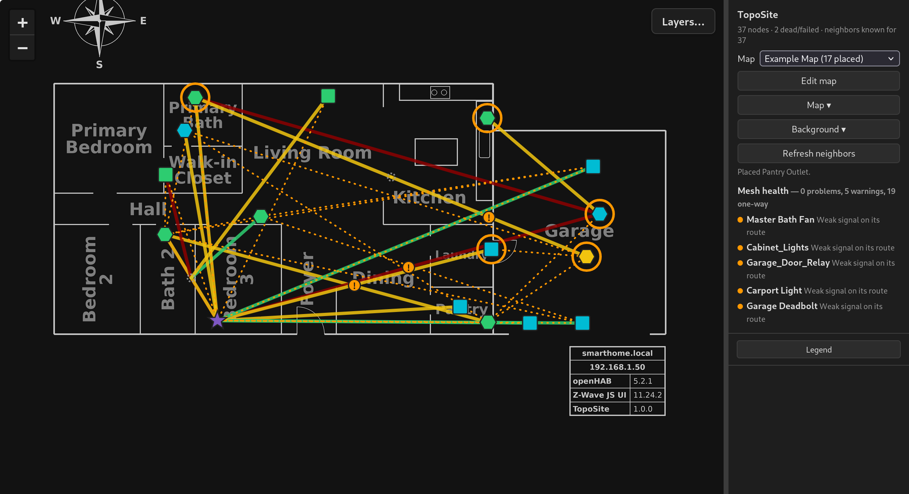
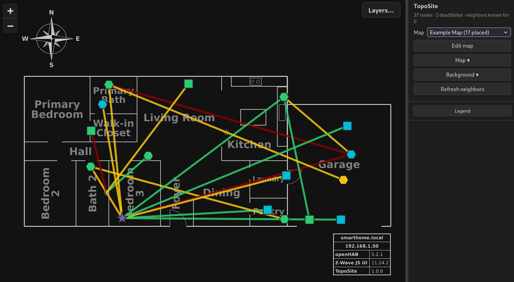
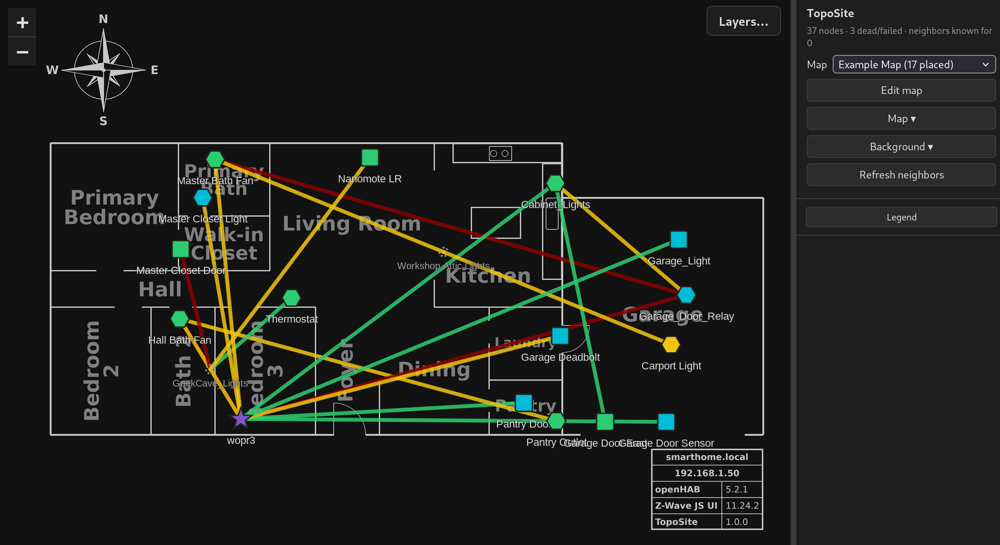
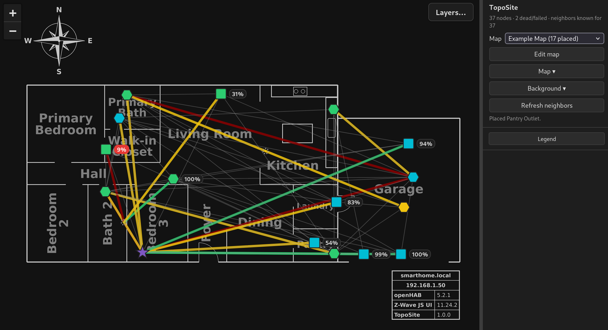
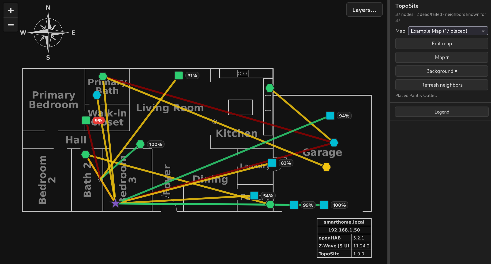
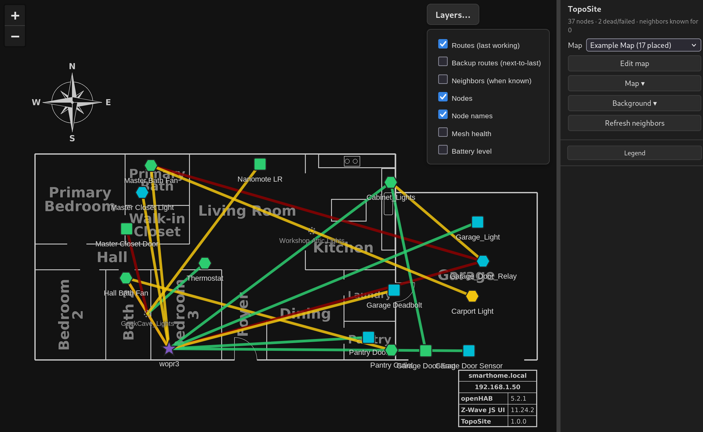

# TopoSite

TopoSite is a [Z-Wave JS UI](https://github.com/zwave-js/zwave-js-ui) plugin
that shows where your Z-Wave devices physically are. It places your nodes as
icons on your own floor plan or background image and draws the mesh links
between them. The way each link is drawn shows the health of the mesh, so
problems stand out at a glance: weak or one-way links, nodes with too few
neighbors, and dead or isolated nodes.

Z-Wave JS UI's own mesh graph shows *how* nodes connect; TopoSite shows that
same mesh laid over *where* the devices actually are, so you can see which
room needs a repeater.



---

## Features

- **Z-Wave mesh on your floor plan** — place nodes on any image (floor plan,
  site plan, satellite screenshot) and see their routes and neighbor links
- **Several maps** — each with its own background, node positions and node
  list (for example: the whole house, just the workshop, only battery nodes)
- **Built-in Network Graph** — a live automatic layout, controller in the middle
- **Familiar symbols** — the same shapes and colors as Z-Wave JS UI's mesh view
  (hexagon = mains, square = battery, star = controller; color = hop count;
  link color = data rate)
- **Mesh health** — flags isolated nodes, nodes with few neighbors, weak route
  hops, one-way neighbor entries and nodes running on their backup route
- **Battery levels** — optional percentage tags with low-battery highlighting
- **Hidden repeaters stay traceable** — a node hidden on a map still shows as a
  small grey dot where it repeats for a node you're looking at
- **Export / import** — move a map to another Z-Wave JS UI install; you review
  how its devices match the new network
- **Follows Z-Wave JS UI** — its light/dark theme and its login
- **Works offline** — everything is served by the plugin, no CDN

### Planned

- **Zoom from the sky into a room** — satellite view of the property, then the
  floor plan, then a 360° photo of a single room with devices placed where they
  really are (see [ROADMAP.md](ROADMAP.md))
- Zigbee (Zigbee2MQTT) and IP device layers on the same map

---

## Screenshots

All taken on an example map in Z-Wave JS UI's dark theme.

**Routes.** Nodes placed on a floor plan, with each node's last working route
back to the controller (the purple star). Node shape shows power: hexagon for
mains (repeats for the mesh), square for battery. Node colour is the hop count
(cyan = direct, green = 2 hops, yellow = 3), and line colour is the data rate
(green 100 kbit/s, yellow 40 kbit/s, dark red 9.6 kbit/s), matching Z-Wave JS
UI's own Network Graph.



**Node names.** The *Node names* layer labels every node. The two faint grey
dots with grey names (*Workshop Attic Lights*, *GeekCave_Lights*) are nodes
hidden on this map that still repeat for nodes shown on it, so their routes
stay traceable.



**Routes and neighbors.** The *Neighbors* layer adds a thin grey line for every
entry in the nodes' neighbor tables, so you can see which devices can hear each
other, not just the routes they use.



**Mesh health.** Amber rings mark nodes with a warning (here, weak signal on
their route), "!" badges sit on the weak hops themselves, and dotted amber
lines show one-way neighbor entries. The pane lists every flagged node; click
one to jump to it.


**Battery levels.** The *Battery level* layer tags each battery node with the
last level it reported. Tags turn amber at 30 % or below and red at 15 % or
below (the 9 % node near the walk-in closet). Hover a node to see when it last
reported.



**Layers.** The *Layers…* button turns each kind of drawing on and off: last
working routes, backup routes, neighbors, nodes, node names, mesh health and
battery levels.
In edit mode, the layers you leave on are saved with the map.



---

## Requirements

- Z-Wave JS UI **11.6.0 or newer** (older releases load plugins a different way)
- Node.js 20 or newer (the official Z-Wave JS UI Docker image already has it)

---

## Installing

TopoSite has no dependencies to install — clone it into Z-Wave JS UI's store
so it's kept with Z-Wave JS UI's data:

```bash
cd /path/to/zwave-js-ui/store          # Docker: the host path of the store volume
mkdir -p plugins && cd plugins
git clone https://github.com/Nutball-Labs/TopoSite.git toposite
```

Then in Z-Wave JS UI: **Settings → General → Plugins**, add the path to
TopoSite's `index.js` as Z-Wave JS UI sees it, press **Enter** so it turns into
a chip, and save:

- Docker: `/usr/src/app/store/plugins/toposite/index.js`
- Other installs: the full path to `toposite/index.js` under your store dir

The path must end in `index.js` — a bare directory won't load. Z-Wave JS UI
reloads plugins when settings are saved; restart it if TopoSite doesn't appear.

To check it loaded, turn on **Settings → General → Log enabled** and look for
`Successfully loaded plugin index.js` in Z-Wave JS UI's console output
(`docker logs zwave-js-ui`). Then open
`http://<zwave-js-ui-host>:8091/toposite/`.

**Updating:** `git pull` in `store/plugins/toposite`, then restart Z-Wave JS UI.

**Your maps** are saved in `store/toposite/` (`layout.json` plus `images/`),
outside the plugin folder, so updating or reinstalling TopoSite never touches
them and Z-Wave JS UI's store backups include them.

**Removing:** delete the entry under Settings → General → Plugins, then the
`store/plugins/toposite` folder (and `store/toposite/` if you don't want to keep
your maps).

> **Note:** TopoSite's data and changes are protected by Z-Wave JS UI's own
> login when that login is turned on. With Z-Wave JS UI's auth off, TopoSite —
> like Z-Wave JS UI itself — is open to anyone who can reach it.

---

## Usage

Open `http://<zwave-js-ui-host>:8091/toposite/`. The pane on the right (drag
its left edge to resize) has:

- **Map** (drop-down): the map you're looking at, with how many nodes are
  placed on each. ★ marks the default map, which opens when TopoSite loads.
  **Network Graph** is built in and lays nodes out automatically; your own maps
  keep their own background, node positions and node list.
- **Edit map**: the map is read-only until this is on. While editing:
  - **Nodes on this map**: tick the nodes to show. *Include all* shows every
    node except the unticked ones (and nodes added to Z-Wave later appear);
    *Exclude all* shows only the ticked ones. **Show only** buttons (All,
    None, Mains, Battery, a location) set the list in one go; the filter box
    narrows it by name or location.
  - **Not placed yet**: shown nodes with no position on this map. Drag one onto
    the map, or click it to drop it in the middle of the view.
  - Drag nodes to move them; **right-click** a node for Unplace or Hide on this map.
  - The zoom, position and layers you leave the map on are saved with it and
    come back next time it's opened (outside edit mode, moving around is temporary).
- **Map ▾**: **New…** (name; background — none, one you already have, or
  upload; include all or exclude all; optionally copy node positions from a
  map on the same background), **Rename…**, **Set as default**, **Delete**
  (click twice), **Export…** (downloads the map as a `.toposite` file; the file
  name starts as the map's name and can be changed) and
  **Import…** (loads one as a new map — you review how each device matches
  this network first; unmatched ones become dashed placeholders you can link
  later in edit mode).
- **Background ▾**: **Set image…** (any PNG, JPEG or WebP up to 25 MB — a floor
  plan export, a drawing, a satellite screenshot), **Set dark-mode image…**
  (shown while Z-Wave JS UI is in dark mode), **Unset**. Node positions stay
  when the background changes. A new map's first image sets its size.
- **Refresh neighbors**: asks Z-Wave JS UI to re-read every node's neighbor
  list (the radio pauses for a few seconds; once a minute at most).
- **Mesh health**: every node on this map with a problem (red: isolated, a
  failed hop, very weak signal) or a warning (amber: few neighbors, weak signal,
  running on its backup route, no route data yet). Click one to jump to it. On
  the map these show as rings around nodes, a "!" on weak route hops, and dotted
  lines for one-way neighbor entries. Mesh health is a layer: Layers… ▸ Mesh
  health turns the markings and this list off and on together. Neighbor counts
  are only judged after **Refresh neighbors** has filled most neighbor tables.
  The thresholds are first guesses and will be tuned.
- **Legend**: shows or hides the legend.

On the map: **Layers…** (top right) toggles routes, backup routes, neighbors,
nodes, **node names**, mesh health and **battery level** (a percentage tag beside each battery
node — amber at 30 % or below, red at 15 % or below; it's the last level the
device reported, and the hover box says when that was).

Nodes hidden on a map aren't drawn, but if one repeats for a shown node's route
it appears as a small grey dot so the route stays traceable (a dashed ring means
its spot is approximate — it has no position on this map).

If Z-Wave JS UI's login is turned on, TopoSite requires the same login: log in
to Z-Wave JS UI in the same browser first.

---

## Project Status

**v0.2.0 — first public release.** Floor-plan maps and the Network Graph for
Z-Wave, with mesh health, battery levels and export/import. Tested on Z-Wave
JS UI 11.24.2 (Docker). Feedback and issue reports are welcome.

---

## Development Paradigm

TopoSite is built the same way as its sister projects
[TagGoblin](https://github.com/Nutball-Labs/TagGoblin),
[FlickImp](https://github.com/Nutball-Labs/FlickImp),
[CamClops](https://github.com/Nutball-Labs/CamClops) — a collaboration between
an experienced Linux sysadmin and Claude (Anthropic's AI), which handles the
implementation under continuous human guidance and review. The architecture,
feature decisions, and real-world testing are entirely human-driven.

---

## Credits

- TopoSite's visual language (node shapes, hop and data-rate colors, route
  styles) follows the Network Graph in
  [Z-Wave JS UI](https://github.com/zwave-js/zwave-js-ui) by Daniel Lando and
  contributors (MIT).
- Bundled: [Leaflet](https://leafletjs.com) 1.9.4 (BSD-2-Clause) and the
  [Socket.IO](https://socket.io) 4.8.4 client (MIT); their licenses are in
  `public/vendor/`.

---

## License

GNU General Public License v3 — see [LICENSE](LICENSE).
Copyright (C) 2026 Nutball Labs / Stephen Berg

<!-- SN: 00002 -->
